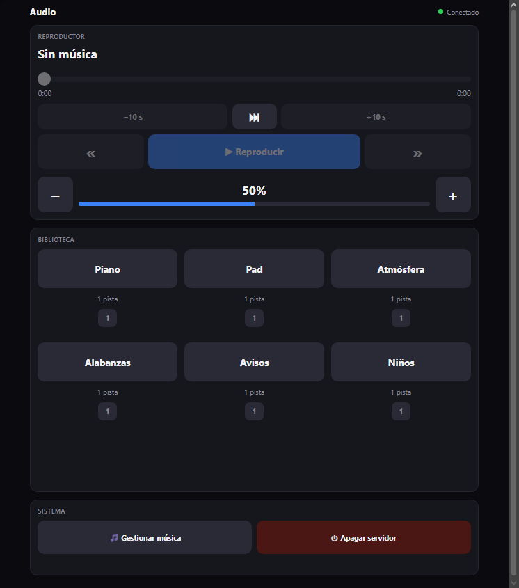
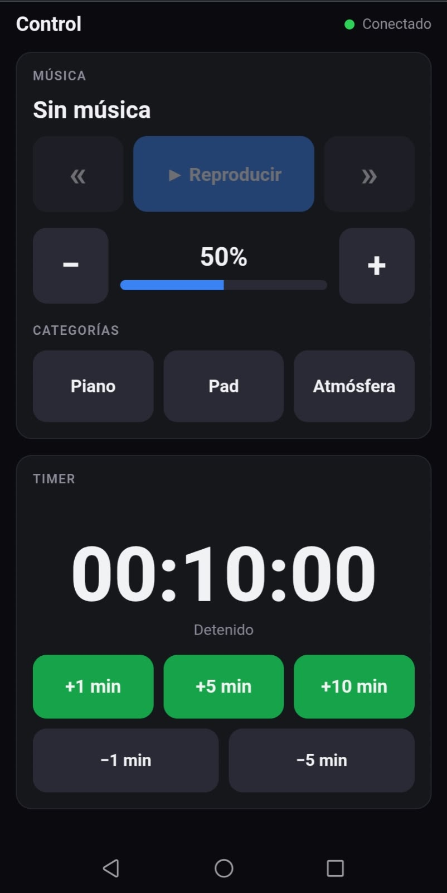
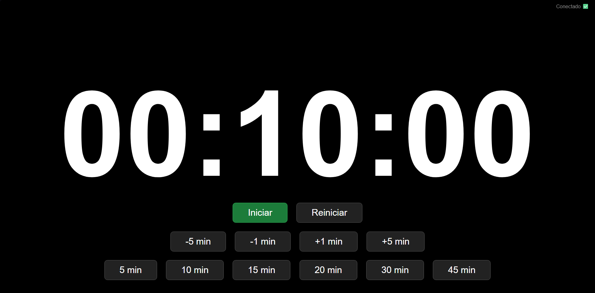
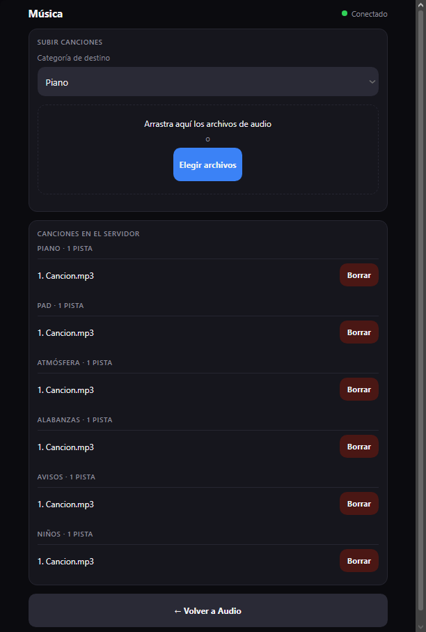

# Church Control

### Desarrollo y Metodología

Este proyecto fue diseñado, estructurado y desplegado para resolver una necesidad operativa real. La implementación del código se realizó mediante **desarrollo asistido por IA** (Claude Code), enfocando el esfuerzo principal en la arquitectura del sistema, la lógica de sincronización en tiempo real, las pruebas de red local y la configuración del servidor de producción.

> Audio de fondo y timer para el servicio de una iglesia, controlados desde el celular dentro de la red local. *(Web app for a church service: background music player and countdown timer, remote-controlled from phones on the local network.)*



## ¿Qué es?

Una herramienta que nació de una necesidad real: durante el servicio, una sola persona opera el audio y el pastor necesita controlar el volumen, cambiar de música y ver cuánto tiempo le queda, sin depender de nadie. Todo funciona **solo en la red local** (sin Internet), y el servidor corre en una laptop antigua sin pantalla.

## Características

**Audio** (`/audio`, `/mobile`)
- Música organizada por categorías: cada carpeta de `music/` es una categoría (Piano, Pad, Atmósfera, Alabanzas, Avisos, Niños).
- Modos de reproducción continua, repetición de una sola pista y reproducción aleatoria; botones de pista anterior y siguiente que nunca salen de la categoría activa.
- Barra de posición con salto de ±10 s, volumen de 5 % en 5 % y casillas numeradas que muestran qué pista suena, cuál sigue y cuántas quedan.

**Timer** (`/timer`, `/mobile`)
- Cuenta regresiva a pantalla completa en formato `HH:MM:SS`, con presets y ajuste de tiempo.
- **Tiempo excedido:** al llegar a cero parpadea en rojo y un contador `+MM:SS` sigue subiendo hasta que se reinicie desde el computador.
- Desde el celular solo se puede sumar o restar tiempo.

**Gestión de música** (`/library`)
- Subida de canciones desde el navegador (arrastrar y soltar, con barra de avance) y borrado con confirmación.

**Servidor**
- Acceso protegido con **PIN**, con sesiones y bloqueo tras intentos fallidos.
- Muestra la **batería** del servidor en `/audio` y avisa si se corta la corriente.
- **Apagado remoto** de la laptop desde la web (doble toque), sin necesidad de abrirla.
- Corre como servicio `systemd`: arranca solo y se reinicia si falla.

## Capturas

| Audio | Celular | Timer | Library |
|---|---|---|---|
|  |  |  |  |

## Arquitectura

```text
 Celular del pastor  (/mobile) ─┐
 Pantalla del timer  (/timer)  ─┼──  Wi-Fi / LAN  ──►  Servidor Node.js (Express + Socket.io)
 Laptop de audio     (/audio)  ─┤                          │
 Gestor de música    (/library)─┘                          └── music/  (archivos de audio)
```

Decisiones de diseño que vale la pena destacar:

- **El servidor es la única fuente de la verdad.** Los clientes envían órdenes y el servidor difunde el estado resultante a todos, así que celular, laptop y pantalla nunca se desincronizan, y quien se reconecta recibe el estado actual.
- **El timer vive en el servidor.** Guarda el instante de término (`endTime`) en vez de restar segundos, de modo que no acumula errores, sobrevive a recargar una página y se muestra igual aunque los relojes de los dispositivos difieran.
- **Seguridad "denegar por defecto".** Toda orden por WebSocket exige una sesión válida, verificada en el servidor; proteger solo las páginas no bastaría.
- **Subida de archivos por *streaming*,** sin librerías: el archivo se escribe a disco por partes (nunca entero en memoria), en un archivo temporal que se renombra al terminar. Hay lista blanca de categorías y formatos, tope de tamaño y protección contra rutas maliciosas.

## Tecnologías

Node.js · Express · Socket.io · HTML5, CSS3 y JavaScript sin frameworks (API `<audio>`).

## Requisitos

- Node.js 18 o superior (recomendado: 24 LTS).
- Música en `.mp3`, `.m4a`, `.wav`, `.ogg`, `.opus`, `.aac`, `.flac` o `.webm`.

## Instalación para desarrollo

```bash
git clone https://github.com/isaac-r718/church-control.git
cd church-control
npm install
```

Crea tu configuración con un PIN de 4 a 8 dígitos (`config.json` no se sube al repositorio):

```bash
# Windows
copy config.example.json config.json
# Linux / macOS
cp config.example.json config.json
```

Edita `config.json`, escribe el PIN y arranca:

```bash
npm start        # o: npm run dev  (reinicio automático con nodemon)
```

La consola muestra las direcciones para abrir desde cada dispositivo. La batería y el apagado remoto solo funcionan en Linux; en otros sistemas no hacen nada.

## Uso

| Ruta | Para qué sirve | Quién la usa |
|---|---|---|
| `/audio` | Reproductor, biblioteca, batería y apagado | Laptop conectada al sonido |
| `/mobile` | Música y ajuste de tiempo del timer | Celular del pastor |
| `/timer` | Cuenta regresiva y sus controles | Pantalla que ve el pastor |
| `/library` | Subir y borrar canciones | Operador |
| `/login` | Ingreso con PIN | Todos |

La música se organiza en carpetas dentro de `music/` (se crean solas al subir la primera canción de cada categoría). El orden y los nombres de las categorías están en `CATEGORY_ORDER`, en `server.js`.

## Estructura

```text
server.js          Servidor: rutas, sesiones, WebSocket, subida de archivos
views/             Páginas HTML (solo se entregan a través de rutas protegidas)
public/css, js     Estilos y scripts del navegador
music/             Archivos de audio (ignorados por Git)
deploy/            Servicio systemd, tapa de la laptop y permiso de apagado
docs/              Guía de despliegue en Linux
```

## Eventos en tiempo real

Todos los eventos del cliente al servidor exigen una sesión válida.

| Cliente → Servidor | Efecto |
|---|---|
| `audio:setCategory`, `audio:toggle`, `audio:next`, `audio:prev`, `audio:toggleMode`, `audio:volumeDelta` | Controlan la reproducción |
| `timer:set`, `timer:start`, `timer:pause`, `timer:reset`, `timer:adjust` | Controlan el timer |
| `system:shutdown` | Apaga el servidor (solo Linux, con permiso `sudoers`) |

| Servidor → Cliente | Contenido |
|---|---|
| `audio:state`, `timer:state` | Estado actual completo |
| `library:data` | Canciones por categoría |
| `power:state` | Batería del servidor |
| `system:shutting-down`, `system:shutdown-failed` | Resultado del apagado |
| `auth:denied` | Sesión inválida o vencida |

## Despliegue en un servidor Linux

La guía paso a paso (Debian sin pantalla, servicio que arranca solo, tapa cerrada, Wi-Fi, IP fija y solución de problemas) está en [`docs/DEPLOYMENT.md`](docs/DEPLOYMENT.md).

## Seguridad

Está pensado para una **red local de confianza**, no para Internet. El tráfico es HTTP sin cifrar, por lo que el PIN protege contra usos accidentales o curiosos, no contra quien pueda espiar la red. No expongas este servidor a Internet.

## Ideas futuras

- Recordar la última pista de cada categoría al volver a ella.
- Apagado automático al llegar a batería crítica.
- Código QR de acceso en `/audio`.

## Licencia

[MIT](LICENSE) © 2026 Isaac
